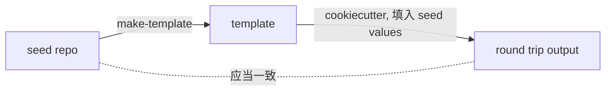

# Parameterization

本文定义如何把 seed 参数化成模板: 什么算参数化正确, 如何选择 seed value, 如何写 selector, 哪些文件排除或原样拷贝, Jinja 冲突和 hooks 怎么处理. 前置阅读: `01-background-and-concepts.md`, `02-repo-layout.md`.

参数化由 `cookiecutter_maker` 库完成. 它的 API (`Maker`, `Parameter` 的字段和语义) 见 `/pypi-cookiecutter_maker`, 本文不重复. 本文只规定 "在 cctpl 中应该怎么用".

## Correctness: Round Trip

**参数化正确的定义: 用 seed 自己的值渲染模板, 得到的项目与 seed 一致.**

"一致" 允许以下差异, 除此之外的任何差异都是参数化错误:

- 被 exclude 的文件 (它们本来就不进模板).
- 由 hooks 生成的文件 (例如 license 文件), 以及 hooks 有意修改的内容.
- 已声明的合法残留所在的文件 (见下文).

round trip 能发现 "替换之后渲染不回原样" 的问题: 派生形态的计算结果与 seed 不同, Jinja 转义出错, 文件丢失或多出, 换行符变化. 这些是 "没有残留的 seed value" 和 "没有未解析的占位符" 两项检查发现不了的.

### What Round Trip Cannot See

round trip **发现不了过度替换** (不该替换的被替换了). 例如 `MIT` 在某个无关文件中被替换成 `{{ cookiecutter.license }}`, 用 seed 的值渲染回来仍然是 `MIT`, 与 seed 完全一致.

过度替换只能靠以下两点防住:

- **预防**: 通用值必须用 context 或 file scope 限定 (见下一节). 这是规则, 不是建议.
- **发现**: 人工查看 template dir 的 diff 时, 留意新出现的 `{{ cookiecutter.xxx }}`. 一个通用变量的占位符出现在意料之外的文件中, 就是过度替换.

round trip 所需的 seed values 就是参数化脚本中声明的 seed values, 不另外维护一份.

## Choosing Seed Values

seed value 是参数化的 "锚点". 选择原则:

- **独特.** 一个 seed value 在 seed 中只应出现在需要参数化的位置. 包名, 仓库名这类 seed value 天然独特, 这正是 seed 使用 `_demo` 命名空间的原因 (见 `01-background-and-concepts.md`).
- **覆盖所有形态.** 同一个概念在 seed 中可能以多种形态出现, 例如包名的 snake case 形式和 slug (kebab case) 形式. 每种形态都要有对应的 parameter. 派生形态不进 `cookiecutter.json`, 而是用 custom placeholder 从主变量计算 (例如 `{{ cookiecutter.package_name | slugify }}`).
- **通用值必须加限定.** 版本号, Python 版本, license 名称这类值 (例如 `1.0.4`, `3.12`, `MIT`) 很可能出现在无关位置. 它们 **绝不能** 作为裸字符串匹配, 必须用以下方式之一限定范围:
  - **context**: selector 带上下文, 例如匹配 `version = "1.0.4"` 而不是 `1.0.4`.
  - **file scope**: 只在指定文件中替换, 例如只在 `pyproject.toml` 和 `_version.py` 中.
- **同一个变量需要多处 context 时**, 拆成多个 parameter. 只有其中一个写入 `cookiecutter.json`, 其余不写入 (否则 `cookiecutter.json` 中会出现重复变量).

带 context 或 file scope 的 selector 一旦与 seed 的写法脱节 (例如格式化改变了空格), 就会一处都匹配不上, 而且不会报错. `check-seed-values` 会报告零命中的 parameter.

参数化脚本是 seed values 和 parameters 的唯一定义处. `cookiecutter.json` 的变量, 默认值, 可选值, prompt 都由它生成, 不手改 `cookiecutter.json` (preset 的默认值由 `presets/*.json` 覆盖, 见 `02-repo-layout.md` 的 Preset Branches).

## Legal Residue

有时一个 seed value 在模板中保留是合理的. 例如一个 no_render 文件必须逐字节保留, 其中又恰好包含 seed value, 而这个值在生成的项目中不会造成问题.

合法残留应当很少见. 遇到残留时先考虑能否用 render, exclude 或 context 解决, 声明残留是最后的手段.

规则:

- 参数化脚本声明哪些 seed value 是 **独特** 的. 只有独特的 seed value 会被 `check-seed-values` 扫描残留; 通用值的正确性靠 context / file scope 规则和人工查看 diff 保证.
- 合法残留必须在参数化脚本中 **显式声明**: 哪个 seed value, 在哪些文件中, 为什么可以保留.
- `check-seed-values` 读取这份声明, 只对未声明的残留报错.
- 不允许通过 "忽略检查输出" 的方式接受残留. 没有声明的残留一律视为错误.
- 声明要尽量窄: 指定到具体文件, 而不是整个目录或整类文件.

## File Filtering

### Input: Git-Visible Files

**参数化的输入是 seed 中 git 认可的文件**: 已被 git 跟踪的文件, 加上未被 `.gitignore` 忽略的新文件 (相当于 `git ls-files --cached --others --exclude-standard`). 被 seed 的 `.gitignore` 忽略的东西 (虚拟环境, 缓存, 构建产物, IDE 配置, 系统文件, 本地私有配置) 从一开始就不进入参数化.

原因: seed 是一个真实项目, 它的 `.gitignore` 本来就准确描述了 "哪些是项目内容, 哪些是本地垃圾". 直接遍历目录再靠手写的 exclude 列表过滤, 每当 seed 多出一种本地缓存 (例如 `.ruff_cache/`, `.DS_Store`), 就会漏进模板. 让 git 来决定输入, exclude 列表就只需要处理 "进了 git 但不该进模板" 的少数文件.

包含未跟踪但未忽略的文件, 是为了在 seed 的改动 commit 之前就能生成模板并检查: "改 seed → 生成模板 → 检查" 通常要循环多次, 最后才提交.

### Three Fates

git 认可的每个文件, 在模板中只有三种命运:

| 命运 | 适用于 | 例子 |
| :--- | :--- | :--- |
| **exclude** (不进入模板) | 进了 git 但不属于 template content 的东西: 由 hooks 生成的文件, 只对 seed 自己有意义的文件 | `LICENSE.txt`, `uv.lock` |
| **no_render** (原样拷贝) | 必须逐字节保持一致, 或体积大且不需要替换的文件; 本身就是 Jinja 模板的文件 | 导出的 requirements 文件, `*.jinja`, `*.html` |
| **render** (默认) | 其他所有文件 | 源码, 配置, 文档 |

注意:

- no_render 的文件中, seed value **不会** 被替换. 把一个文件加入 no_render 之前, 确认它不含 seed value, 或者把其中的 seed value 声明为合法残留.
- 新增一个 seed 文件时, 先判断它属于哪种命运. 默认是 render; 只有确实需要时才加入 exclude 或 no_render.
- 文件和目录的 **名字** 总是会被参数化, 不受 no_render 影响.
- **lock 文件 exclude, 不进入模板.** lock 文件中记录了 seed 自己的包名, 原样拷贝会留下错误的值, 而生成的项目第一次安装依赖时本来就要重新 lock. 生成的项目因此会 resolve 当时最新的依赖版本, 而不是 seed 测试时的版本. 所以只在 seed 中测试是不够的: 生成的项目必须在全新 resolve 的依赖上再安装并测试一次.

## Jinja Conflicts

seed 中的文件可能本来就含有 Jinja 风格的语法, 例如 GitHub Actions 的 `${{ matrix.os }}`, Sphinx 模板中的 ``. cookiecutter 渲染时会把它们当成自己的变量, 导致生成失败或内容错误.

`cookiecutter_maker` 在参数化时会自动用 `` 转义这些语法. 因此:

- **不要在 seed 中手工转义.** seed 必须保持为合法, 可运行的源码.
- **不要为了躲避 Jinja 冲突而把文件加入 no_render.** 那样会连带失去参数化. no_render 只用于上一节列出的情况.
- 渲染后的项目中出现 `{%` 或 `{{` 是正常的 (它们来自 seed 原本的内容). 判断是否有问题, 以 round trip 为准.

## Hooks

hooks 处理字符串替换做不到的事情:

- 根据变量选择内容, 例如根据 license 选择生成哪份 license 文件.
- 生成计算出来的内容, 例如当前年份.
- 根据变量增删文件.

规则:

- hooks 是 tpl repo 的 source, 维护在根目录的 `hooks/` 中 (见 `02-repo-layout.md`).
- 能用参数化解决的, 不用 hooks. hooks 的逻辑在 seed 中无法运行和测试, 越少越好.
- 由 hooks 生成的文件, 在 seed 中也存在 (seed 需要它), 但必须加入 exclude, 并在参数化脚本中声明为 hooks 的产物, round trip 才会允许它的差异.
- 有可选值 (choice) 的变量如果会影响 hooks 的行为, 必须声明 choice coverage (见下一节).

### Choice Coverage

用默认值生成项目, 只会走到每个 choice 变量默认值对应的分支. 如果一个 choice 变量的不同值会让 hooks 或模板走不同的分支 (例如不同的 license 生成不同的 license 文件), 其余分支就从来没有被生成过, 出错也发现不了.

规则:

- 这类变量在参数化脚本的 `CHOICE_COVERAGE` 中声明.
- 生成测试项目时, 每个声明的变量的 **每个可选值** 都至少生成一次.
- 一次只改变一个变量, 其余保持默认值, 不做全组合. 原因: 组合数随变量个数成倍增长, 而这类分支通常彼此独立.

## Changing Parameters

新增或修改一个 parameter 会同时涉及 seed (写入或修改 seed value) 和 tpl (参数化脚本). 它是 `cctpl-add-param-cn` 的职责, 至少要考虑:

- seed 中的 seed value 是否独特, 是否需要 context 或 file scope.
- 是否有派生形态需要额外的 parameter.
- 是否影响 hooks.
- 是否需要声明合法残留.
- 是否需要 choice coverage.
- 对 preset 的影响: 重命名或删除变量后, 修改引用它的 `presets/*.json` (格式见 `02-repo-layout.md` 的 Preset Branches).
