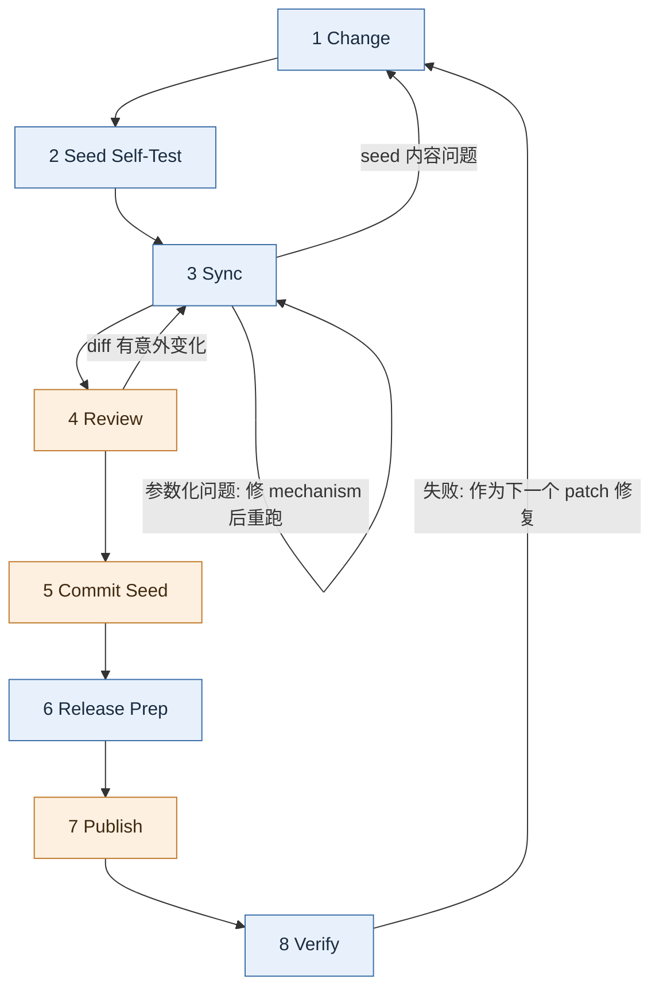

# Workflow

本文定义一次模板迭代的完整生命周期: 有哪些阶段, 每个阶段由谁执行, 进入和离开的条件, 失败时退回哪里. 前置阅读: `01-background-and-concepts.md`, `02-repo-layout.md`.

## Overview

蓝色阶段由 agent 执行, 橙色阶段由人执行. agent 在每个由人执行的阶段之前停下, 交出控制权.

## Stages

| # | Stage | 执行者 | 入口条件 | 产出 | Skill |
| :--- | :--- | :--- | :--- | :--- | :--- |
| 1 | Change | agent | 一个改动需求 | seed 或 tpl source 中的改动 | `cctpl-change-cn`, `cctpl-add-param-cn` |
| 2 | Seed Self-Test | agent | seed 有改动 | seed 自己的测试 (及文档构建, 如相关) 通过 | `cctpl-change-cn` |
| 3 | Sync | agent | 阶段 1, 2 完成 | 新的 artifact 已从 `tmp/cctpl/template/` 应用到 tpl repo, 所有检查通过 | `cctpl-sync-cn` |
| 4 | Review | 你 | 阶段 3 通过 | 你认可 tpl repo 中 artifact 的 diff | — |
| 5 | Commit Seed | 你 | 阶段 4 通过 | seed 工作区干净, 已 push | — (agent 打印命令) |
| 6 | Release Prep | agent | seed 干净且已 push | tpl 版本号已 bump, `release-history.rst` 已更新并记录 seed SHA, 发布命令已打印 | `cctpl-release-cn` |
| 7 | Publish | 你 | 阶段 6 完成 | tpl commit + push, `preset/*` 已 merge, GitHub release 已创建 | — (执行打印的命令) |
| 8 | Verify | agent | 阶段 7 完成 | 从 GitHub 拉取已发布模板生成项目, 测试通过 | `cctpl-verify-cn` |

### 1 Change

先按 `01-background-and-concepts.md` 的 "Two Kinds of Change" 归类:

- template content → 改 seed.
- template mechanism → 改 tpl repo 的 source (参数化脚本, `hooks/` 等).
- 新增或修改 parameter → 两边都改, 用 `cctpl-add-param-cn`.

**不改 artifact.** 如果需求表述为 "改 template dir 中的某个文件", 翻译成 "改 seed 中对应的文件".

### 2 Seed Self-Test

在 seed 中运行它自己的测试. 改动涉及文档时也构建文档. 目的是保证进入参数化的素材本身是对的, 把 "seed 本身有 bug" 和 "参数化有 bug" 两类问题分开.

只改了 template mechanism 时跳过本阶段.

### 3 Sync

在 tpl repo 中依次运行: 生成模板 → 检查 seed value 残留 → 用模板生成测试项目 → 检查未解析占位符 → 应用到 tpl repo. 具体 task 和退出码见 `04-mise-task-contract.md`, 检查层级见 `08-verification.md`.

任何一步失败:

- seed value 残留, 占位符未解析, Jinja 冲突 → 修参数化逻辑 (template mechanism), 从本阶段开头重跑.
- 问题出在 seed 内容本身 → 退回阶段 1.

本阶段结束后 agent 停下, 告诉你可以 review.

### 4 Review

你查看 tpl repo 中 artifact (`cookiecutter.json`, template dir) 的 git diff. diff 应该只包含本次改动预期的变化. 出现意外变化 (例如大量无关文件被重新渲染) 时退回阶段 3 排查.

### 5 Commit Seed

你提交并 push seed 的改动. agent 只负责打印建议的命令.

之所以在 Release Prep 之前, 是因为 Release Prep 要记录 seed 的 commit SHA, 这个 SHA 必须是一个已经 push 的, 别人也能找到的 commit.

### 6 Release Prep

前置检查:

- seed 工作区干净, 当前 commit 已 push.
- tpl repo 的 artifact 确实有变化 (或者有值得发布的 source 改动).

然后:

1. 根据本次改动类型给出 tpl 版本号的 bump 建议, 你确认后修改 `pyproject.toml`.
2. 用 `/py-changelog` 更新 tpl 的 `release-history.rst`.
3. 在当前版本条目中记录 seed commit SHA.
4. 打印阶段 7 需要你执行的全部命令.

规则细节见 `07-versioning-and-release.md`.

### 7 Publish

你执行阶段 6 打印的命令: tpl commit, push `main`, 把 `main` merge 进所有 `preset/*` 分支并 push, 创建 GitHub release. agent 不执行其中任何一步, 见 `06-safety-rules.md`.

### 8 Verify

从 GitHub 拉取刚发布的模板 (包括 `main` 和需要验证的 `preset/*`), 生成项目到 `tmp/cctpl/verify/`, 在生成的项目中运行测试和文档构建. 这是唯一一个验证 "用户实际拿到的东西" 的阶段: 前面所有检查用的都是本地 `tmp/cctpl/template/` 中的模板.

失败时, 修复从阶段 1 重新开始, 作为下一个 patch 版本发布.

## Handoff Rules

- **agent 自动串联的范围:** 阶段 1 → 2 → 3 可以在同一会话中连续执行. 阶段 3 结束后必须停下.
- **只能由你触发的阶段:** 6 (`/cctpl-release-cn`) 和 8 (`/cctpl-verify-cn`). agent 不自动进入.
- **每次停下时**, agent 说清楚三件事: 当前完成到哪个阶段, 结果如何, 下一步由谁做什么 (需要你执行命令时, 按 `06-safety-rules.md` 的格式给出).
- **一次迭代可以包含多次 Change.** 阶段 1 → 3 可以反复循环, 攒够一批改动再进入阶段 4.
