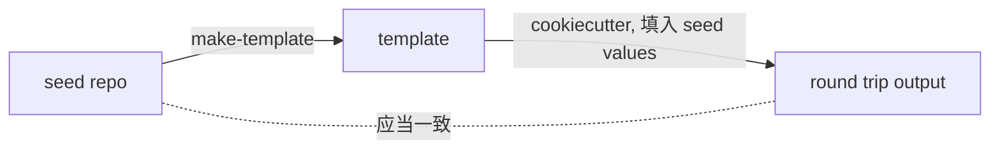

# Parameterization

本文定义如何把 seed 参数化成模板: 什么算参数化正确, 如何选择 seed value, 如何写 selector, 哪些文件排除或原样拷贝, Jinja 冲突和 hooks 怎么处理. 前置阅读: `01-background-and-concepts.md`, `02-repo-layout.md`.

参数化由 `cookiecutter_maker` 库完成. 它的 API (`Maker`, `Parameter` 的字段和语义) 见 `/pypi-cookiecutter_maker`, 本文不重复. 本文只规定 "在 cctpl 中应该怎么用".

## Correctness: Round Trip

**参数化正确的定义: 用 seed 自己的值渲染模板, 得到的项目与 seed 一致.**

"一致" 允许以下差异, 除此之外的任何差异都是参数化错误:

- 被 exclude 的文件 (它们本来就不进模板).
- 由 hooks 生成的文件 (例如 license 文件), 以及 hooks 有意修改的内容.
- 已声明的合法残留所在的文件 (见下文).

这条定义比 "没有残留的 seed value" 和 "没有未解析的占位符" 都强: 前两项检查只能发现 "该替换的没替换" 和 "替换了但没渲染", round trip 还能发现 "不该替换的被替换了" (例如一个依赖的版本号被误当成项目版本号). 本节的所有规则都是为了让 round trip 成立.

round trip 所需的 seed values 就是参数化脚本中声明的 seed values, 不另外维护一份.

## Choosing Seed Values

seed value 是参数化的 "锚点". 选择原则:

- **独特.** 一个 seed value 在 seed 中只应出现在需要参数化的位置. 包名, 仓库名这类 seed value 天然独特, 这正是 seed 使用 `_demo` 命名空间的原因 (见 `01-background-and-concepts.md`).
- **覆盖所有形态.** 同一个概念在 seed 中可能以多种形态出现, 例如包名的 snake case 形式和 slug (kebab case) 形式. 每种形态都要有对应的 parameter. 派生形态不进 `cookiecutter.json`, 而是用 custom placeholder 从主变量计算 (例如 `{{ cookiecutter.package_name | slugify }}`).
- **通用值必须加限定.** 版本号, Python 版本, license 名称这类值 (例如 `1.0.4`, `3.12`, `MIT`) 很可能出现在无关位置. 它们 **绝不能** 作为裸字符串匹配, 必须用以下方式之一限定范围:
  - **context**: selector 带上下文, 例如匹配 `version = "1.0.4"` 而不是 `1.0.4`.
  - **file scope**: 只在指定文件中替换, 例如只在 `pyproject.toml` 和 `_version.py` 中.
- **同一个变量需要多处 context 时**, 拆成多个 parameter. 只有其中一个写入 `cookiecutter.json`, 其余不写入 (否则 `cookiecutter.json` 中会出现重复变量).

参数化脚本是 seed values 和 parameters 的唯一定义处. `cookiecutter.json` 的变量, 默认值, 可选值, prompt 都由它生成, 不手改 `cookiecutter.json` (preset 的例外见 `07-versioning-and-release.md`).

## Legal Residue

有时一个 seed value 在模板中保留是合理的. 例如原样拷贝的 lock 文件中包含 seed 的包名, 而生成的项目第一次安装依赖时会重新生成 lock 文件.

规则:

- 合法残留必须在参数化脚本中 **显式声明**: 哪个 seed value, 在哪些文件中, 为什么可以保留.
- `check-seed-values` 读取这份声明, 只对未声明的残留报错.
- 不允许通过 "忽略检查输出" 的方式接受残留. 没有声明的残留一律视为错误.
- 声明要尽量窄: 指定到具体文件, 而不是整个目录或整类文件.

## File Filtering

seed 中的每个文件, 在模板中只有三种命运:

| 命运 | 适用于 | 例子 |
| :--- | :--- | :--- |
| **exclude** (不进入模板) | 不属于 template content 的东西: 版本控制数据, 虚拟环境, 缓存, 构建产物, 本地私有配置, 草稿文件, 以及由 hooks 生成的文件 | `.git`, `.venv`, `dist`, `.claude/settings.local.json`, `LICENSE.txt` |
| **no_render** (原样拷贝) | 必须逐字节保持一致, 或体积大且不需要替换的文件; 本身就是 Jinja 模板的文件 | lock 文件, 导出的 requirements 文件, `*.jinja`, `*.html` |
| **render** (默认) | 其他所有文件 | 源码, 配置, 文档 |

注意:

- no_render 的文件中, seed value **不会** 被替换. 把一个文件加入 no_render 之前, 确认它不含 seed value, 或者把其中的 seed value 声明为合法残留.
- 新增一个 seed 文件时, 先判断它属于哪种命运. 默认是 render; 只有确实需要时才加入 exclude 或 no_render.
- 文件和目录的 **名字** 总是会被参数化, 不受 no_render 影响.

## Jinja Conflicts

seed 中的文件可能本来就含有 Jinja 风格的语法, 例如 GitHub Actions 的 `${{ matrix.os }}`, Sphinx 模板中的 ``. cookiecutter 渲染时会把它们当成自己的变量, 导致生成失败或内容错误.

`cookiecutter_maker` 在参数化时会自动用 `` 转义这些语法. 因此:

- **不要在 seed 中手工转义.** seed 必须保持为合法, 可运行的源码.
- **不要为了躲避 Jinja 冲突而把文件加入 no_render.** 那样会连带失去参数化. no_render 只用于上一节列出的情况.
- 渲染后的项目中出现 `{%` 或 `{{` 是正常的 (它们来自 seed 原本的内容). 判断是否有问题, 以 round trip 为准.

## Hooks

hooks 处理字符串替换做不到的事情:

- 根据变量选择内容, 例如根据 license 选择生成哪份 license 文件.
- 生成计算出来的内容, 例如当前年份.
- 根据变量增删文件.

规则:

- hooks 是 tpl repo 的 source, 维护在根目录的 `hooks/` 中 (见 `02-repo-layout.md`).
- 能用参数化解决的, 不用 hooks. hooks 的逻辑在 seed 中无法运行和测试, 越少越好.
- 由 hooks 生成的文件, 在 seed 中也存在 (seed 需要它), 但必须加入 exclude, 并在 round trip 中被允许差异.
- 有可选值 (choice) 的变量如果会影响 hooks 的行为, 每个可选值都要在验证中覆盖到 (见 `08-verification.md`).

## Changing Parameters

新增或修改一个 parameter 会同时涉及 seed (写入或修改 seed value) 和 tpl (参数化脚本). 它是 `cctpl-add-param-cn` 的职责, 至少要考虑:

- seed 中的 seed value 是否独特, 是否需要 context 或 file scope.
- 是否有派生形态需要额外的 parameter.
- 是否影响 hooks.
- 是否需要声明合法残留.
- 对 preset 的影响 (见 `07-versioning-and-release.md`).
- 对 tpl 版本号的影响: 新增变量是 minor, 重命名或删除变量是 major (见 `07-versioning-and-release.md`).
