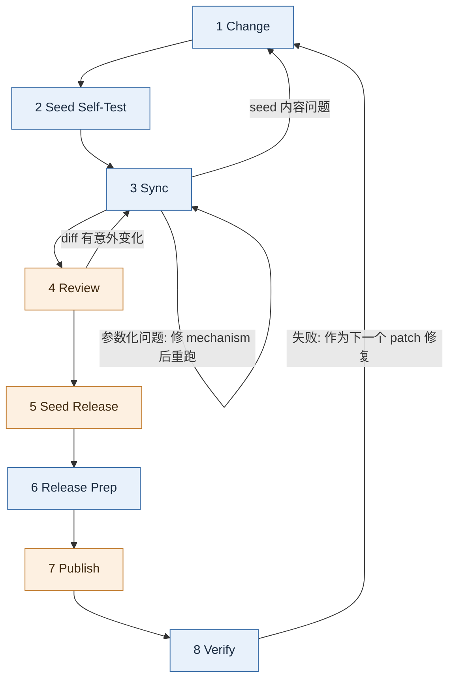

# Workflow

本文定义一次模板迭代的完整生命周期: 有哪些阶段, 每个阶段由谁执行, 进入和离开的条件, 失败时退回哪里. 前置阅读: `01-background-and-concepts.md`, `02-repo-layout.md`, `03-parameterization.md`, `04-safety-rules.md`.

## Overview

蓝色阶段由 agent 执行, 橙色阶段由人执行. agent 在每个由人执行的阶段之前停下, 交出控制权.

## Stages

| # | Stage | 执行者 | 入口条件 | 产出 | Skill |
| :--- | :--- | :--- | :--- | :--- | :--- |
| 1 | Change | agent | 一个改动需求 | seed 或 tpl source 中的改动 | `cctpl-change-cn`, `cctpl-add-param-cn` |
| 2 | Seed Self-Test | agent | seed 有改动 | seed 自己的测试 (及文档构建, 如相关) 通过 | `cctpl-change-cn` |
| 3 | Sync | agent | 阶段 1, 2 完成 | 新的 artifact 已从 `tmp/cctpl/template/` 应用到 tpl repo, 所有检查通过 | `cctpl-sync-cn` |
| 4 | Review | 你 | 阶段 3 通过 | 你认可 tpl repo 中 artifact 的 diff | — |
| 5 | Seed Release | 你 (agent 准备) | 阶段 4 通过 | 共用版本号已在 seed 中 bump, seed changelog 已写, 重新 Sync 过; seed 已 commit, push, 发布到 PyPI 并打上同名 tag | seed 的 `pywf-oss-changelog-seed-repo` (agent 打印其余命令) |
| 6 | Release Prep | agent | seed 已打上当前版本的 tag | tpl 的 `release-history.rst` 已写好当前版本条目 (seed 链接, tpl 自身改动), `check-release` 通过, 发布命令已打印 | `cctpl-release-cn`, `cctpl-changelog-cn` |
| 7 | Publish | 你 | 阶段 6 完成 | tpl commit + push, tag 和 GitHub release 已创建, `preset/*` 已重新生成并推送 | — (执行打印的命令) |
| 8 | Verify | agent | 阶段 7 完成 | 从 GitHub 拉取已发布模板生成项目, 测试通过 | `cctpl-verify-cn` |

### 1 Change

先按 `01-background-and-concepts.md` 的 "Two Kinds of Change" 归类:

- template content → 改 seed.
- template mechanism → 改 tpl repo 的 source (参数化脚本, `hooks/` 等).
- 新增或修改 parameter → 两边都改, 用 `cctpl-add-param-cn`.

**不改 artifact.** 如果需求表述为 "改 template dir 中的某个文件", 翻译成 "改 seed 中对应的文件".

### 2 Seed Self-Test

在 seed 中运行它自己的测试 task; 改动涉及文档时, 也运行它的文档构建 task. 具体 task 名见 seed 的 `mise.toml`, 不同的仓库对各不相同. 只运行本地 task, 不运行发布类 task (见 `04-safety-rules.md`). 目的是保证进入参数化的素材本身是对的, 把 "seed 本身有 bug" 和 "参数化有 bug" 两类问题分开.

只改了 template mechanism 时跳过本阶段.

### 3 Sync

在 tpl repo 中运行 `mise run sync`, 它依次执行: 生成模板 → 检查 seed 的共用版本号 (`check-version`) → 检查 seed value 残留 → 用模板生成测试项目 (含 choice coverage) → 检查未解析占位符 → round trip 比较 → 检查 presets → 把 artifact 应用到 tpl repo, 并把 seed 的版本号复制到 tpl repo. 任何一步失败立即停止. 这些步骤只读写本地文件, 速度快, 每次都全部运行.

改动涉及依赖, 构建, 测试配置, hooks 或 parameter 时, 本阶段还要在生成的项目中安装依赖并运行测试. 这一步较慢, 不包含在 `sync` 中, 按需单独运行. `mise run e2e` 把 `sync` 和 Local Trial (见下文) 串在一起, 一条命令完成 Sync 和生成项目的完整试用.

任何一步失败:

- seed value 残留, 占位符未解析, Jinja 冲突 → 修参数化逻辑 (template mechanism), 从本阶段开头重跑.
- 问题出在 seed 内容本身 → 退回阶段 1.

本阶段结束后 agent 停下, 告诉你可以 review.

### 4 Review

你查看 tpl repo 中 artifact (`cookiecutter.json`, template dir, `README.rst`) 的 git diff. diff 应该只包含本次改动预期的变化. 出现意外变化 (例如大量无关文件被重新渲染) 时退回阶段 3 排查.

### 5 Seed Release

共用版本号只在 seed 中 bump (见 `01-background-and-concepts.md` 的 One Shared Version), 所以每次发布都从 seed 开始:

1. agent 在 seed 中用 `pywf-oss-changelog-seed-repo`: 建议 bump 级别, 你确认后修改 seed 的 `pyproject.toml`, 并在 `release-history-seed-repo.rst` 中写当前版本的条目. 只改了 tpl repo 机制的发布也要 bump, seed 条目注明 "seed 无变化".
2. agent 重新运行 `sync` (或 `e2e`), 把新版本号复制到 tpl repo. 这次 artifact 的 diff 应当只多出版本号.
3. 你在 seed 中 commit, push, 然后运行 seed 自己的发布 task (发布到 PyPI, 打同名 tag 并创建 GitHub release). agent 只打印命令.

之所以在 Release Prep 之前, 是因为 tpl 的 changelog 要链接 seed 的 tag, 而这个 tag 就是 "模板由哪个 seed commit 生成" 的记录. 它必须已经在远端, 别人也能找到.

### 6 Release Prep

agent 用 `check-release` 确认: seed 干净, 已 push, 当前版本的 tag 在 seed HEAD 上; tpl repo 中的版本号与 seed 一致; artifact 是最新的; tpl 还没有这个版本的 tag. 然后用 `cctpl-changelog-cn` 写 tpl 的 `release-history.rst` 条目 (开头是 seed 链接, 下面是 tpl repo 自身的改动), 再次运行 `check-release`, 全部通过后打印阶段 7 需要你执行的命令.

只改了 tpl repo 自身 (cctpl 文档, `.mise/tasks/` 等) 而模板产物没有变化时, 不进入阶段 5 和本阶段: 改动照常由你 commit, 但不发布.

### 7 Publish

你执行阶段 6 打印的发布命令. 它先重跑 `check-release` 的全部检查, 有任何问题就在推送之前停下; 然后提交并推送 tpl repo, 创建 tag 和 GitHub release, 最后运行 `publish-presets` 重新生成 preset 分支. 已存在的 tag 永远不会被移动或覆盖: 这个版本号已有 tag 时, 检查就失败, 什么都不推送. preset 推送失败时只重跑 `publish-presets`. agent 不执行其中任何一步, 见 `04-safety-rules.md`.

### 8 Verify

从 GitHub 拉取刚发布的模板 (包括 `main` 和需要验证的 `preset/*`), 生成项目到 `tmp/cctpl/verify/`, 与本地模板生成的结果逐字节比较, 再在生成的项目中安装依赖并运行测试. 这是唯一一个验证 "用户实际拿到的东西" 的阶段: 前面所有检查用的都是本地 `tmp/cctpl/template/` 中的模板.

失败时, 修复从阶段 1 重新开始, 作为下一个 patch 版本发布. 已发布的版本不重新发布.

## Handoff Rules

- **agent 自动串联的范围:** 阶段 1 → 2 → 3 可以在同一会话中连续执行. 阶段 3 结束后必须停下. 原因: Review 是你的质量关口. 你必须在 seed 提交之前看到 artifact 的 diff, 否则问题会被一起提交, 甚至进入发布.
- **只能由你触发的阶段:** 5 (在 seed 中说 "发布" 或 "bump 版本"), 6 (`/cctpl-release-cn`) 和 8 (`/cctpl-verify-cn`). agent 不自动进入. 原因: 阶段 5 决定 "发不发布, 发哪个版本", 阶段 5 和 7 发布之后都无法撤回; 阶段 8 必须在你执行完阶段 7 之后才有意义, 只有你知道发布是否已经完成.
- **每次停下时**, agent 说清楚三件事: 当前完成到哪个阶段, 结果如何, 下一步由谁做什么 (需要你执行命令时, 按 `04-safety-rules.md` 的格式给出).
- **一次迭代可以包含多次 Change.** 阶段 1 → 3 可以反复循环, 攒够一批改动再进入阶段 4.

## Outside the Stages: Local Trial

`mise run try-template` (或 `mise run try-template <preset>`) 从 seed 当前的工作区生成模板, 用默认值或某个 preset 渲染一个项目, 再在项目中运行它自己的 mise task (安装, 测试覆盖率, 文档构建). 它不检查也不应用 artifact, 不属于任何阶段, 随时可用. 最常见的用途是 Review 之前亲眼看看生成项目的效果.
