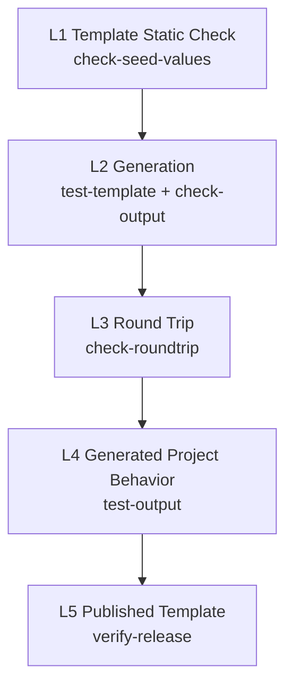

# Verification

本文定义模板的验证层级: 每一层验证什么, 由哪个 task 完成, 什么样的改动需要跑到哪一层. 前置阅读: `03-parameterization.md`, `05-workflow.md`.

## Levels

验证分为五层. 越往下越接近 "使用者实际拿到的东西", 也越慢.

| Level | 验证什么 | Task | 发现的典型问题 | 阶段 |
| :--- | :--- | :--- | :--- | :--- |
| L1 Template Static Check | 模板中没有未声明的 seed value 残留 | `check-seed-values` | 漏掉的 seed value 形态, no_render 文件中的 seed value | 3 Sync |
| L2 Generation | 用默认值能生成项目, 生成结果中没有未解析的变量 | `test-template`, `check-output` | Jinja 语法错误, hooks 报错, 引用了不存在的变量 | 3 Sync |
| L3 Round Trip | 用 seed values 渲染模板, 结果与 seed 一致 | `check-roundtrip` | 派生形态计算结果与 seed 不同, Jinja 转义出错, 文件丢失或多出. **发现不了过度替换** (见 03 的 What Round Trip Cannot See) | 3 Sync |
| L4 Generated Project Behavior | 用默认值生成的项目能安装依赖, 测试通过; choice coverage 生成的每个项目都能构建 wheel | `test-output` | 默认值导致项目无法工作, 项目依赖了 seed 特有的东西, 某个可选值让打包失败 (例如不合法的 license 表达式) | 3 Sync (按需) |
| L5 Published Template | 从 GitHub 拉取的已发布模板与本地一致, 生成的项目能工作 | `verify-release` | 发布时漏拷贝文件, preset 分支内容错误 | 8 Verify |

**seed 自己的测试不属于以上任何一层.** 它在阶段 2 Seed Self-Test 中运行, 保证的是参数化的素材本身是对的. 以上五层保证的是 "参数化和发布没有破坏它".

## L1 – L3: Every Sync

L1, L2, L3 包含在 `sync` 中, 每次 Sync 都运行, 不做取舍. 它们只涉及本地文件, 不安装依赖, 速度快.

### Choice Coverage

L2 除了用默认值生成一次, 还要按 `03-parameterization.md` 的 Choice Coverage, 为 `CHOICE_COVERAGE` 中每个变量的其余可选值各生成一次.

## L4: When Needed

L4 需要为生成的项目安装完整依赖, 耗时长, 所以按需运行. 改动涉及以下任一项时, Sync 阶段必须运行 L4:

- 依赖 (`pyproject.toml` 的依赖声明, lock 文件).
- 构建, 测试, 文档构建的配置.
- 生成项目中的 mise task 或其脚本.
- hooks.
- parameter 的新增, 修改, 默认值或可选值的变化.

只涉及文档文字, 注释, 或不参与运行的文件时, 可以跳过 L4.

### Secrets

生成项目的 `mise.toml` 可能在 `[env]` 中通过命令从 secret 存储读取 token. 用默认值生成的项目, token 字段名是占位值, 读取一定失败. seed 的写法让读取失败时得到空字符串, 所以 mise 本身还能运行, 但每次加载配置都会执行一遍读取命令 (可能需要网络和外部工具).

规则: **L4 不依赖任何 secret, 也不经过 mise.** 在生成的项目中直接调用工具链 (例如用 uv 安装, 直接运行 pytest). 原因:

- L4 要回答的问题是 "生成的项目能不能安装, 测试能不能通过". 它的结果不应该取决于本机有没有 secret 存储, 网络是否可用.
- 读取失败被静默转成空字符串, 如果 L4 经过 mise, secret 相关的问题既不会让 L4 失败, 也不会被报告, 只会让结果更难解释.

经过 mise 的完整试用由 Local Trial 负责 (见下文). 需要真实 secret 才能验证的功能 (发布到 PyPI, 配置 Codecov 等) 不在 L4 的范围内, 它们由 seed 在真实环境中验证.

## Local Trial

除了五个层级, 还有一个 **推荐的人工试用机制** `try-template`: 用和人手工测试完全相同的方式试用模板. 它从 seed 当前的工作区生成模板, 渲染一个项目, 再进入项目通过 mise 运行 `try_template.py` 的 `PROJECT_TASKS` 中列出的 task (通常是创建虚拟环境, 安装, 测试覆盖率, 文档构建).

与 L4 的区别:

| | L4 (`test-output`) | Local Trial (`try-template`) |
| :--- | :--- | :--- |
| 经过 mise | 否, 直接调用 uv 和 pytest | 是, 运行生成项目自己的 mise task |
| 覆盖范围 | 依赖安装, 单元测试 | 生成项目的 `mise.toml`, 工具版本, task 脚本, 测试覆盖率, 文档构建 |
| 渲染所用的值 | 默认值 | 默认值, 或任意一个 preset |
| 是否依赖 secret | 否 | preset 的 token 字段指向真实 secret 时会读取 (只进入环境变量, 不打印) |
| 在流程中的位置 | Sync 阶段按需运行 | 任何时候, 尤其是 Review 前想亲眼看看效果时 |

隔离规则:

- 生成项目的 `mise.toml` 只在本次运行中被信任 (`MISE_TRUSTED_CONFIG_PATHS`), 不写入 mise 的信任记录.
- 用 `MISE_CEILING_PATHS` 阻止 mise 向上加载 tpl repo 自己的 `mise.toml`, 让试用环境与一个独立的新项目一致.
- 人想接着手工操作时, 进入项目目录, 自己运行一次 `mise trust`. 注意手工操作时 mise 会同时加载上层 tpl repo 的配置.
- 它会先重新生成模板, 覆盖 `tmp/cctpl/stage/` 和 `tmp/cctpl/template/`. 所以之后运行 L4 或 L5 前, `template/` 对应的是 seed 当前的工作区, 而不一定是最近一次 Sync 或发布时的 seed 状态.

日志: 每一步输出 `[try i/n] <时间> <步骤>`, 子命令的输出以 `|` 缩进, 每个命令结束时输出退出码和耗时; 最后输出每个 task 的 PASS / FAIL / SKIP 汇总. 全部内容同时写入 `tmp/cctpl/try/<label>.log`.

### Manual Testing Recipe

人在本地测试模板的推荐顺序. 所有命令都在 tpl repo 根目录开始.

1. **从 seed 重新生成并检查** (推荐, 但可省略): `mise run sync`. 它跑完 L1 – L3 并把 artifact 应用到 tpl repo, 之后 `git diff` 就能看到本次改动. 只想看效果, 不想动 artifact 时跳过这一步: 第 2 步自己会从 seed 重新生成模板.
2. **生成项目并自动跑一圈**: `mise run try-template` (默认值) 或 `mise run try-template <preset>`. 它从 seed 当前的工作区生成模板 (包括尚未 commit 的改动), 渲染项目, 并在项目中通过 mise 运行 `PROJECT_TASKS` 中的 task. 看最后的 `=== Try result`.
3. **进入项目亲手看** (可选): 进入 `tmp/cctpl/try/<label>/<project>/`, 第一次先运行 `mise trust`, 然后运行任何想看的 task, 例如 `mise run view-cov`, `mise run view-doc` 在浏览器中查看覆盖率报告和文档, 或者重跑 `mise run cov`.

seed 改了之后, 从第 1 步 (或第 2 步) 重新开始即可; 第 2 步每次都会清空并重建 `tmp/cctpl/try/<label>/`.

## L5: After Publish

L5 是阶段 8 Verify 的内容, 由 `verify-release` 完成, 在 forked context 中运行 (见 `cctpl-verify-cn`).

对 `main` 和每个 `preset/*` 分支:

1. **拉取.** 用 `cookiecutter gh:<owner>/<repo> --checkout <branch> --no-input` 生成项目到 `tmp/cctpl/verify/<branch>/`. 确保拿到的是刚发布的版本, 而不是 cookiecutter 本地缓存的旧克隆.
2. **与本地比较.** 用本地 `tmp/cctpl/template/` 和该分支的默认值 (`main` 用 `cookiecutter.json` 的默认值, `preset/<name>` 用 `presets/<name>.json` 覆盖后的默认值) 再生成一次, 两者必须逐字节一致. 不一致说明发布过程丢失或多出了文件 (例如 `cookiecutter.json` 没有随 template dir 一起更新), 或 preset 分支没有正确生成.
3. **运行.** 按 L4 的方式安装依赖并运行测试.

### Report

L5 在 forked context 中运行, 只把结论带回主会话:

- 每个分支: 通过 / 失败.
- 失败时: 哪一步失败, 涉及的文件和行号, 初步判断的原因.
- 不带回完整的安装和测试日志.

## Levels by Change

| 改动 | L1 | L2 | L3 | L4 | L5 |
| :--- | :--- | :--- | :--- | :--- | :--- |
| seed 中的文档, 注释 | 是 | 是 | 是 | 否 | 发布后 |
| seed 中的源码, 测试 | 是 | 是 | 是 | 否 (seed 自测已覆盖) | 发布后 |
| seed 中的依赖, 构建, 测试, CI 配置, mise task | 是 | 是 | 是 | 是 | 发布后 |
| parameter 新增或修改 | 是 | 是, 并检查 `CHOICE_COVERAGE` 是否需要更新 | 是 | 是 | 发布后 |
| hooks | 是 | 是, 并检查 `CHOICE_COVERAGE` 是否需要更新 | 是 | 是 | 发布后 |
| exclude / no_render 规则 | 是 | 是 | 是 | 否 | 发布后 |
| 只改 tpl repo 自身 (cctpl 文档, `.mise/tasks/`) | 是 (确认模板产物无变化) | 是 | 是 | 否 | 不发布 |

改 `.mise/tasks/` 时也要跑 L1 – L3: 不是为了验证模板, 而是为了确认改过的 task 本身仍然工作, 并且 artifact 没有意外变化.
