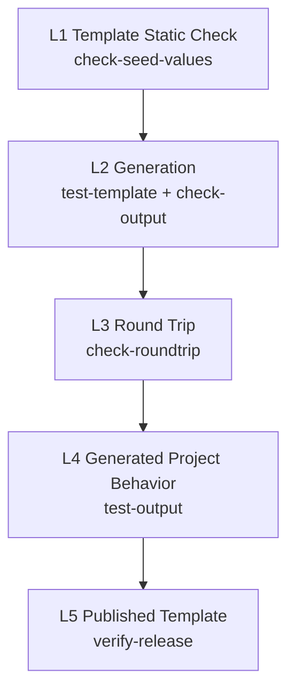

# Verification

本文定义模板的验证层级: 每一层验证什么, 由哪个 task 完成, 什么样的改动需要跑到哪一层. 前置阅读: `03-workflow.md`, `04-mise-task-contract.md`, `05-parameterization.md`.

## Levels

验证分为五层. 越往下越接近 "使用者实际拿到的东西", 也越慢.

| Level | 验证什么 | Task | 发现的典型问题 | 阶段 |
| :--- | :--- | :--- | :--- | :--- |
| L1 Template Static Check | 模板中没有未声明的 seed value 残留 | `check-seed-values` | 漏掉的 seed value 形态, no_render 文件中的 seed value | 3 Sync |
| L2 Generation | 用默认值能生成项目, 生成结果中没有未解析的变量 | `test-template`, `check-output` | Jinja 语法错误, hooks 报错, 引用了不存在的变量 | 3 Sync |
| L3 Round Trip | 用 seed values 渲染模板, 结果与 seed 一致 | `check-roundtrip` | 不该替换的被替换了, 派生形态计算结果与 seed 不同, 文件丢失 | 3 Sync |
| L4 Generated Project Behavior | 用默认值生成的项目能安装依赖, 测试通过 | `test-output` | 默认值导致项目无法工作, 项目依赖了 seed 特有的东西 | 3 Sync (按需) |
| L5 Published Template | 从 GitHub 拉取的已发布模板与本地一致, 生成的项目能工作 | `verify-release` | 发布时漏拷贝文件, preset 分支内容错误 | 8 Verify |

**seed 自己的测试不属于以上任何一层.** 它在阶段 2 Seed Self-Test 中运行, 保证的是参数化的素材本身是对的. 以上五层保证的是 "参数化和发布没有破坏它".

## L1 – L3: Every Sync

L1, L2, L3 包含在 `sync` 中, 每次 Sync 都运行, 不做取舍. 它们只涉及本地文件, 不安装依赖, 速度快.

### Choice Coverage

L2 默认只用 `cookiecutter.json` 的默认值生成一次. 对于有可选值 (choice) 的变量, 如果不同的值会让 hooks 或模板走不同的分支 (例如不同的 license 生成不同的文件), 默认值之外的分支在 L2 中不会被覆盖.

规则: 这类变量的 **每个可选值** 都至少生成一次. 一次只改变一个变量, 其余保持默认值, 不做全组合.

## L4: When Needed

L4 需要为生成的项目安装完整依赖, 耗时长, 所以按需运行. 改动涉及以下任一项时, Sync 阶段必须运行 L4:

- 依赖 (`pyproject.toml` 的依赖声明, lock 文件).
- 构建, 测试, 文档构建的配置.
- 生成项目中的 mise task 或其脚本.
- hooks.
- parameter 的新增, 修改, 默认值或可选值的变化.

只涉及文档文字, 注释, 或不参与运行的文件时, 可以跳过 L4.

### Secrets

生成项目的 `mise.toml` 可能在 `[env]` 中通过命令从 secret 存储读取 token. 用默认值生成的项目, token 字段名是占位值, 读取会失败, 进而可能导致任何会加载该配置的 mise 命令失败.

规则: **L4 不依赖任何 secret.** 在生成的项目中直接调用工具链 (例如用 uv 安装, 直接运行 pytest), 而不是通过会加载 `[env]` 的 mise 命令. 需要 secret 才能验证的功能 (发布到 PyPI, 配置 Codecov 等) 不在 L4 的范围内, 它们由 seed 在真实环境中验证.

## L5: After Publish

L5 是阶段 8 Verify 的内容, 由 `verify-release` 完成, 在 forked context 中运行 (见 `cctpl-verify-cn`).

对 `main` 和每个 `preset/*` 分支:

1. **拉取.** 用 `cookiecutter gh:<owner>/<repo> --checkout <branch> --no-input` 生成项目到 `tmp/cctpl/verify/<branch>/`. 确保拿到的是刚发布的版本, 而不是 cookiecutter 本地缓存的旧克隆.
2. **与本地比较 (仅 `main`).** 用默认值从已发布模板生成的项目, 应与 L2 从本地模板生成的项目一致. 不一致说明发布过程丢失或多出了文件, 例如 `cookiecutter.json` 没有随 template dir 一起更新.
3. **检查 preset (仅 `preset/*`).** 生成的项目中, preset 覆盖的变量应当体现为 preset 的值, 其余变量为 `main` 的默认值.
4. **运行.** 按 L4 的方式安装依赖并运行测试.

### Report

L5 在 forked context 中运行, 只把结论带回主会话:

- 每个分支: 通过 / 失败.
- 失败时: 哪一步失败, 涉及的文件和行号, 初步判断的原因 (参考 `09-troubleshooting.md`).
- 不带回完整的安装和测试日志.

## Levels by Change

| 改动 | L1 | L2 | L3 | L4 | L5 |
| :--- | :--- | :--- | :--- | :--- | :--- |
| seed 中的文档, 注释 | 是 | 是 | 是 | 否 | 发布后 |
| seed 中的源码, 测试 | 是 | 是 | 是 | 否 (seed 自测已覆盖) | 发布后 |
| seed 中的依赖, 构建, 测试, CI 配置, mise task | 是 | 是 | 是 | 是 | 发布后 |
| parameter 新增或修改 | 是 | 是 + choice coverage | 是 | 是 | 发布后 |
| hooks | 是 | 是 + choice coverage | 是 | 是 | 发布后 |
| exclude / no_render 规则 | 是 | 是 | 是 | 否 | 发布后 |
| 只改 tpl repo 自身 (cctpl 文档, `.mise/tasks/`) | 是 (确认 artifact 无变化) | 是 | 是 | 否 | 不发布 |

改 `.mise/tasks/` 时也要跑 L1 – L3: 不是为了验证模板, 而是为了确认改过的 task 本身仍然工作, 并且 artifact 没有意外变化.
