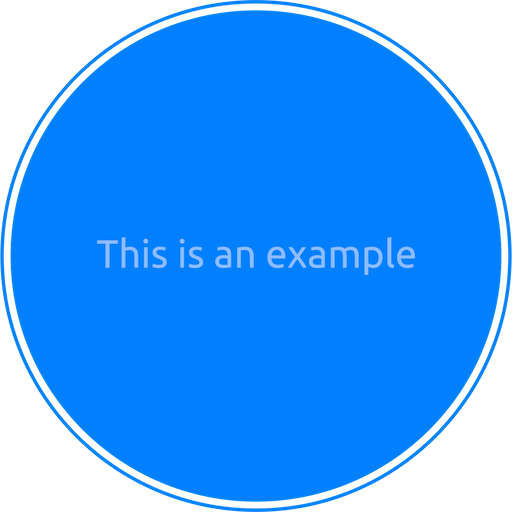

.. _sample-rst-document:

Sample RestructuredText Document
==============================================================================
This page demonstrates every documentation feature this template supports. Read it next to its source, ``docs/source/01-Sample-RestructuredText-Document/index.rst``, and copy what you need. The notebook version of this page is :ref:`sample-jupyter-notebook-document`.


Headings and Labels
------------------------------------------------------------------------------
Heading underlines are 78 characters long: ``=`` for the page title, ``-`` for sections, ``~`` for subsections. Put a label such as ``.. _sample-rst-document:`` above a title so other pages can link to it with ``:ref:``.


A Subsection
~~~~~~~~~~~~~~~~~~~~~~~~~~~~~~~~~~~~~~~~~~~~~~~~~~~~~~~~~~~~~~~~~~~~~~~~~~~~~~
Subsections use the ``~`` underline.


Inline Markup
------------------------------------------------------------------------------
- **Bold**, *italic*, and ``inline code``.
- An external link: `Sphinx documentation <https://www.sphinx-doc.org/>`_.
- Custom color and style roles from ``_static/.custom-style.rst``: :red:`red`, :blue:`blue`, :green:`green`, :strike:`strike`.


Cross-References to the API
------------------------------------------------------------------------------
Always write the full dotted path from the defining module, then choose how it is displayed. The left column is the source; the right column is the rendered link.

.. list-table::
    :header-rows: 1
    :widths: 60 40

    * - Source
      - Rendered
    * - ``:mod:`{{ cookiecutter.package_name }}.example_module_1```
      - :mod:`{{ cookiecutter.package_name }}.example_module_1`
    * - ``:class:`~{{ cookiecutter.package_name }}.example_module_1.Greeter```
      - :class:`~{{ cookiecutter.package_name }}.example_module_1.Greeter`
    * - ``:class:`{{ cookiecutter.package_name }}.example_module_1.Greeter```
      - :class:`{{ cookiecutter.package_name }}.example_module_1.Greeter`
    * - ``:meth:`Greeter.greet <{{ cookiecutter.package_name }}.example_module_1.Greeter.greet>```
      - :meth:`Greeter.greet <{{ cookiecutter.package_name }}.example_module_1.Greeter.greet>`
    * - ``:func:`~{{ cookiecutter.package_name }}.example_module_1.greet```
      - :func:`~{{ cookiecutter.package_name }}.example_module_1.greet`
    * - ``:func:`example_module_1.greet <{{ cookiecutter.package_name }}.example_module_1.greet>```
      - :func:`example_module_1.greet <{{ cookiecutter.package_name }}.example_module_1.greet>`
    * - ``:func:`~{{ cookiecutter.package_name }}.example_package_1.example_module_2.multi_two```
      - :func:`~{{ cookiecutter.package_name }}.example_package_1.example_module_2.multi_two`
    * - ``:attr:`~{{ cookiecutter.package_name }}.example_module_1.DEFAULT_NAME```
      - :attr:`~{{ cookiecutter.package_name }}.example_module_1.DEFAULT_NAME`
    * - ``:attr:`Greeter.greeting <{{ cookiecutter.package_name }}.example_module_1.Greeter.greeting>```
      - :attr:`Greeter.greeting <{{ cookiecutter.package_name }}.example_module_1.Greeter.greeting>`
    * - ``:class:`pathlib.Path``` (standard library, through intersphinx)
      - :class:`pathlib.Path`


Cross-References to Pages
------------------------------------------------------------------------------
- By label: :ref:`sample-jupyter-notebook-document`, or with custom text: :ref:`the notebook sample <sample-jupyter-notebook-document>`.
- By file: :doc:`../02-Sample-Jupyter-Notebook-Document/index`.
- The changelog: :ref:`release_history`.


Code
------------------------------------------------------------------------------
A code block:

.. code-block:: python

    from {{ cookiecutter.package_name }}.api import Greeter

    print(Greeter(greeting="Hi").greet("Alice"))

A block pulled from the real source, so it never goes stale:

.. literalinclude:: ../../../{{ cookiecutter.package_name }}/example_module_1.py
    :language: python
    :pyobject: Greeter

An API entry embedded in a guide page (``:no-index:`` avoids a duplicate with the API reference):

.. autofunction:: {{ cookiecutter.package_name }}.example_module_1.greet
    :no-index:


Admonitions
------------------------------------------------------------------------------
.. note::

    A note for useful background.

.. tip::

    A tip for a better way to do something.

.. warning::

    A warning for something that can go wrong.


Tables
------------------------------------------------------------------------------
Add ``:class: sortable`` to make a table sortable by clicking its header (``_static/js/sorttable.js``):

.. list-table::
    :header-rows: 1
    :class: sortable

    * - Python
      - Status
    * - 3.11
      - supported
    * - 3.12
      - supported
    * - 3.13
      - supported
    * - 3.14
      - supported


Data Rendered from Code (sphinx-jinja)
------------------------------------------------------------------------------
This table is generated from ``doc_data`` in ``{{ cookiecutter.package_name }}/docs/__init__.py``, so it updates itself when the public API changes:

.. jinja:: doc_data

    .. list-table::
        :header-rows: 1

        * - Name
          - Summary
        {% for row in doc_data.public_api %}
        * - ``{{ row.name }}``
          - {{ row.summary }}
        {% endfor %}


Layout (sphinx-design)
------------------------------------------------------------------------------
Grids, cards, tabs, dropdowns, badges, buttons, and icons are shown in :ref:`sample-sphinx-design-gallery`.


Images
------------------------------------------------------------------------------
Images live next to the page that uses them, or in ``_static/``:


